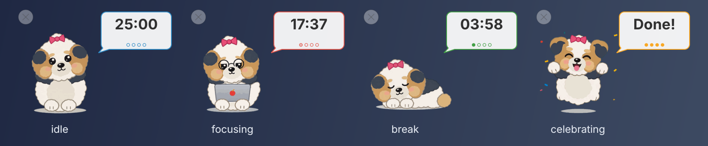
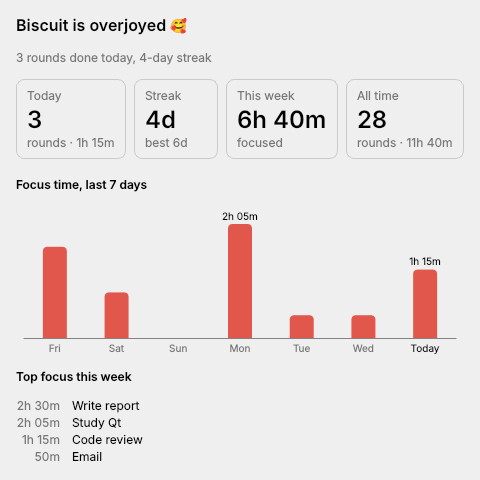
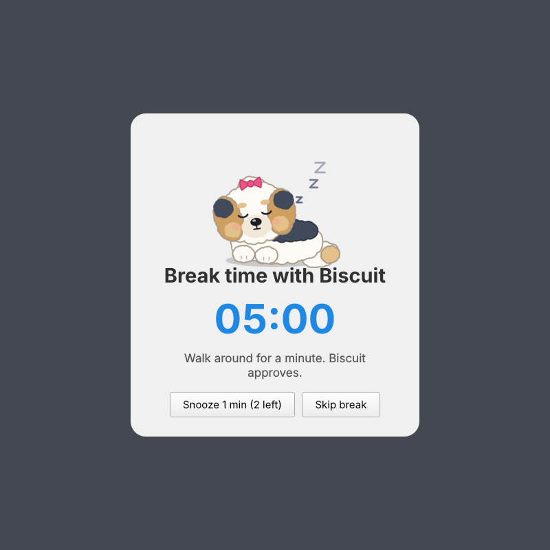

# Pomodoro Pet 🐶🍅

A tiny desktop pet for **KDE Plasma** (Wayland first) that runs your Pomodoro
timer. The pet is a fluffy **Bichon Frise × Biewer Terrier** pup: white Bichon
fluff, Biewer tricolour (blue-black saddle, gold ears and brows) and a top-knot
with a pink bow.



- Frameless, transparent, always-on-top window with an animated pup
- Drag it anywhere. Its position is remembered between launches
- Click the pup to set focus / short break / long break / rounds
  (defaults **25 / 5 / 15 / 4**) and to Start / Pause / Skip / Reset
- Speech bubble with the remaining time, colour-coded by phase, plus
  round-progress dots
- Four animation states: **idle**, **focusing** (glasses + laptop),
  **break** (napping), **celebrating** (after each focus round and at the end
  of the session)
- KDE notification and a soft chime when a phase ends (both optional)
- **Do Not Disturb while focusing:** Plasma silences other notifications during
  focus rounds and lets them through again on breaks
- **Global shortcut** <kbd>Meta</kbd>+<kbd>Shift</kbd>+<kbd>P</kbd> to start
  or pause, plus a command-line remote (`pomodoro-pet --toggle`, `--status`, …)
- **Sleep-proof:** time keeps counting while the laptop is suspended. If a
  phase ended while you were away, the pup waits for you instead of silently
  running the next one
- **Resumes after restarts and crashes:** the current session is saved and
  picked up on the next launch
- **Focus intention:** type what you're working on. It's shown on hover,
  included in notifications and logged with each round
- **Stats:** today's rounds and focus time, day streaks, a 7-day chart and
  your top focus topics, in a stats window or with `pomodoro-pet --stats`
- **Pauses when you step away:** no keyboard/mouse for 3 minutes, or a
  locked screen, pauses the focus round without counting the idle time. When
  you're back you choose *Resume* or *I was working, count it*
- **Break enforcement:** keep working during a break and the pup wiggles and
  nags you, or in *Dim the screen* mode a full-screen break reminder appears
  with snooze and skip
- **A pup with moods:** Biscuit (rename it in the config) cheers up as you
  finish rounds and build streaks, floats hearts when happy, and sulks under a
  rain cloud if you skip or work through breaks, abandon rounds or stay away
  for days
- The little **×** quits completely. No tray icon, no background process
- Settings live in `~/.config/pomodoro-pet/config.json`

Built with Python 3 + PySide6 (Qt 6).

---

## Run from source

```bash
sudo pacman -S --needed python pyside6 libnotify   # CachyOS / Arch
git clone https://github.com/TheShield2594/meeki.git pomodoro-pet
cd pomodoro-pet
python -m pomodoro_pet
```

Options:

```
python -m pomodoro_pet --toggle           # start/pause (launches the pet if needed)
python -m pomodoro_pet --status           # e.g. "Focus · round 2/4 · 12:34 left — Write report"
python -m pomodoro_pet --intention "Write report" --start
python -m pomodoro_pet --stats            # print your stats (no running pet needed)
python -m pomodoro_pet --backend xcb      # force XWayland for this run
python -m pomodoro_pet --reset-position   # forget the saved position
python -m pomodoro_pet -v                 # verbose logging
```

To get a launcher entry without packaging (runs from the checkout):

```bash
packaging/install-user.sh          # adds ~/.local/bin/pomodoro-pet + menu entry + icon
packaging/install-user.sh --uninstall
```

With a virtualenv instead of the system PySide6:

```bash
python -m venv .venv && . .venv/bin/activate
pip install -e .
pomodoro-pet
```

## Install as an Arch package

The PKGBUILD builds from this checkout:

```bash
cd packaging/arch
makepkg -si
```

This installs:

| Path | What |
|---|---|
| `/usr/bin/pomodoro-pet` | launcher |
| `/usr/lib/python3.x/site-packages/pomodoro_pet/` | the app |
| `/usr/share/pomodoro-pet/assets/` | sprites, sound, icon |
| `/usr/share/applications/pomodoro-pet.desktop` | KDE app-launcher entry |
| `/usr/share/kglobalaccel/pomodoro-pet.desktop` | global shortcuts (symlink) |
| `/usr/share/icons/hicolor/*/apps/pomodoro-pet.png` | icon |
| `/usr/share/pomodoro-pet/kwin/` | optional KWin window rule + installer |

Optional dependencies: `libnotify` (notifications), `pipewire` or `libpulse`
(sound), `xorg-xwayland` (XWayland fallback), `kconfig` (rule installer).

## Using it

| Action | How |
|---|---|
| Open the controls | click the pup or the bubble |
| Move the pup | drag it |
| Start / pause from anywhere | <kbd>Meta</kbd>+<kbd>Shift</kbd>+<kbd>P</kbd> |
| Set what you're working on | type it in the popover's top field, then <kbd>Enter</kbd> to start |
| See stats | **Stats** button in the popover |
| Check status and mood | hover the pup |
| Quit | the small **×** at the top-left (shows clearly on hover) |

While the popover is open you can change durations. Changes to a running phase
take effect from the next phase. An idle timer updates immediately. With
`auto_advance` on (the default), breaks and focus rounds follow each other
automatically. After the long break the session is complete, and the pup
celebrates.

The bubble dims and shows a pause sign while the timer is paused, and the pup
freezes mid-pose.

### Keyboard shortcuts and remote control

The launcher entry has three actions: *Start / Pause Timer*, *Skip Current
Phase* and *Reset Session*. Both install methods also register them as KDE
global shortcuts. Start/Pause defaults to <kbd>Meta</kbd>+<kbd>Shift</kbd>+<kbd>P</kbd>.
The other two have no default, so you can bind them in *System Settings →
Keyboard → Shortcuts → Pomodoro Pet*. New shortcut files are picked up at your
next login.

The shortcuts run the same commands you can use in a terminal or script:

| Command | Effect |
|---|---|
| `pomodoro-pet --toggle` | start or pause. Launches the pet and starts if it isn't running |
| `pomodoro-pet --start` / `--pause` | start/resume, or pause |
| `pomodoro-pet --skip` | end the current phase now |
| `pomodoro-pet --reset` | back to round 1, idle |
| `pomodoro-pet --show` | bring the pet back (e.g. from tray mode) |
| `pomodoro-pet --status` | print the phase, time left and intention (exit code 1 if not running) |
| `pomodoro-pet --intention "TEXT"` | set what you're focusing on. Combine with `--start` |
| `pomodoro-pet --stats` | print stats and the pup's mood. Reads the log, so the pet needn't be running |

Launching `pomodoro-pet` again while it's running doesn't create a second pet.
Under the hood the commands are D-Bus calls (`io.github.pomodoropet`,
`/PomodoroPet`, methods `Toggle`, `Start`, `Pause`, `Skip`, `Reset`, `Show`,
`Status`, `SetIntention(s)`), so anything that can call D-Bus can drive the timer.

### Do Not Disturb

While a focus round is running, Pomodoro Pet asks Plasma to hold back other
notifications, the same as the *Do not disturb* switch in the notification
applet. Pausing, breaks and quitting end it, and Plasma also ends it if the app
crashes, so it can't get stuck on. Turn it off with the checkbox in the popover
or `"dnd_during_focus": false`.

### Suspend, restarts and crashes

- The timer counts real elapsed time, including while the machine is
  suspended.
- If a phase ended while you were away (lid closed, app not running), you get
  a *"Welcome back"* notification, and the timer waits paused at the start of
  the next phase. Press start when you're ready.
- The current session (phase, round, end time) is written to
  `~/.local/state/pomodoro-pet/session.json` at every change and on quit. The
  next launch picks it up. Sessions older than 12 hours are dropped.

### Focus intention

When you open the popover with the timer stopped, the cursor is already in the
*"What are you focusing on?"* field. Type the task and press
<kbd>Enter</kbd> to start. Earlier entries are suggested as you type. The
intention stays until you change it. It appears in the hover tooltip,
`--status` and the focus-done notification, and it's recorded with every round
for the stats.

### Stats

Every phase that ends (finished, skipped or reset) is appended to
`~/.local/share/pomodoro-pet/history.jsonl`, one JSON object per line, so it's
easy to process with `jq` or a spreadsheet. The **Stats** window shows:



- **Today:** finished rounds and focused time. Partly done rounds count toward
  time but not toward rounds
- **Streak:** consecutive days with at least one finished round, plus your best.
  A streak survives until midnight, so today doesn't break it before you start
- **This week** and **all time** totals
- **Focus time, last 7 days** as a bar chart (hover a bar for the exact value)
- **Top focus this week:** time per intention

### Stepping away (idle detection)

Pomodoro Pet asks the desktop how long it's been since your last keyboard or
mouse input. On Plasma it uses `org.freedesktop.ScreenSaver`, on both X11 and
Wayland. GNOME and plain X11 have fallbacks.

- **During a focus round:** after `idle_minutes` (default 3) without input,
  or as soon as the screen locks, the round pauses. The idle minutes before
  the pause are given back, so they don't count as focus.
- **When you're back:** the pup says hello and a notification offers
  **Resume** or **I was working, count it**. The second option is for reading,
  a call or whiteboarding: the time away counts as focus and the timer resumes
  (finishing the round if that covers it). You can also click the pup or press
  the shortcut. Set `"idle_auto_resume": true` to resume without asking.
- **During breaks:** being away is the point, so nothing pauses.

Turn it off with *Pause when I step away* in the popover.

### Break enforcement

The **Breaks** setting in the popover decides how the pup handles you working
through a break:

- **Nudge me** (default): the first 20 seconds of a break are free. After
  that, 30 seconds of continuous keyboard/mouse use gets a wiggle and a
  reminder, then another every minute, each a bit firmer. The third also sends
  a notification. Stepping away resets it.
- **Dim the screen:** every monitor gets a full-screen break reminder with the
  napping pup, the countdown and a stretch/rest tip. **Snooze 1 min** (twice
  per break) or **Skip break** if you really must. It closes by itself when
  the break ends.
- **Off.**



The time you spent at the computer during each break is logged. A break
spent mostly working counts against the pup's mood almost like a skipped one.

### The pup's mood

Biscuit's mood comes from your history, not from a random roll:

| Makes it happier | Makes it sulk |
|---|---|
| finishing focus rounds today | skipping a break |
| keeping a day streak | abandoning a round (skip/reset after a minute or more) |
| | working through most of a break |
| | not seeing you for two days or more |

Five levels: *overjoyed 🥰* and *happy 😊* float hearts, *content 🙂* is the
normal pup, and *sulky 😤* and *sad 🥺* switch to the grumpy rain-cloud pose.
The pup also comments on what just happened in a little speech tooltip. The
popover and the hover tooltip show the current mood and why. The mood is
checked every 10 minutes too, so a new day or a long absence shows up without
any action from you.

## Configuration

`~/.config/pomodoro-pet/config.json` (or `$XDG_CONFIG_HOME/pomodoro-pet/`) is
written automatically. Keys:

| Key | Default | Meaning |
|---|---|---|
| `focus_minutes` | `25` | focus length (1–240) |
| `short_break_minutes` | `5` | short break (1–120) |
| `long_break_minutes` | `15` | long break (1–240) |
| `rounds` | `4` | focus rounds before the long break (1–12) |
| `auto_advance` | `true` | start the next phase automatically |
| `notifications` | `true` | KDE notification when a phase ends |
| `dnd_during_focus` | `true` | Plasma Do Not Disturb during focus rounds |
| `idle_pause` | `true` | pause focus rounds when you step away |
| `idle_minutes` | `3` | minutes without input that count as away (1–60). A locked screen counts at once |
| `idle_auto_resume` | `false` | resume by itself when you're back, instead of asking |
| `break_enforcement` | `"nudge"` | `"nudge"`, `"overlay"` (dim the screen) or `"off"` |
| `sound` | `true` | play a chime when a phase ends |
| `sound_file` | `null` | custom `.wav`/`.ogg` instead of the bundled chime |
| `pet_name` | `"Biscuit"` | what the pup is called |
| `position` | `null` | last window position (`{"x":…, "y":…}`), managed for you |
| `scale` | `1.0` | pet size multiplier (0.5–4) |
| `sprite_dir` | `null` | folder with your own sprites (see below) |
| `backend` | `"auto"` | `"auto"`, `"wayland"` or `"xcb"` (see Wayland notes) |
| `kwin_integration` | `true` | use KWin scripting for keep-above/positioning on Wayland |
| `minimize_to_tray` | `false` | **experimental stub**, see below |

Edit it while the app is closed. The app rewrites it on quit.

## Custom sprites

Sprites are looked up per state (`idle`, `focusing`, `break`, `celebrating`,
and the optional `sulky` idle pose for a low mood) in `sprite_dir` first, then
the bundled `assets/sprites/`. Each state can be:

- a folder of frames: `<state>/00.png`, `<state>/01.png`, … (sorted by name), or
- a horizontal sprite sheet `<state>.png` made of square frames.

Frames are drawn at about 112 logical px, so 224–256 px PNGs look crisp on
HiDPI. Missing states fall back to the bundled art. The bundled placeholder art
and the chime are generated by `tools/generate_assets.py`. Tweak and re-run it,
or drop real art over the PNGs.

## Wayland notes and limitations

Plain Wayland deliberately gives apps **no way to choose their own position,
read it back, or stay above other windows**. Qt silently ignores `move()` and
`WindowStaysOnTopHint` there. Pomodoro Pet handles this as follows:

1. **KDE Plasma Wayland (default, native).** On start the app loads a small
   **KWin script** over D-Bus (`org.kde.KWin /Scripting`). The script finds the
   pet window by app-id + title and:
   - sets *keep above* and hides it from the taskbar, pager and Alt+Tab,
   - moves it to the saved position,
   - reports every position change back to the app over D-Bus, so the position
     can be saved.

   It also keeps the full-screen break reminder windows above everything else.

   The script is unloaded when you quit. Dragging uses
   `QWindow.startSystemMove()`, the Wayland-native way to move a window, so it
   works without any of the above.
2. **Other Wayland compositors** (GNOME, Sway, …) with `backend: "auto"`: the app
   starts under **XWayland** (`QT_QPA_PLATFORM=xcb`), where positioning and
   always-on-top work as on X11. Needs `xorg-xwayland`.
3. **X11 sessions:** everything works natively.

If the KWin script can't load (unusual Plasma build, scripting disabled), the
app keeps running and logs a hint. Then pick one of these fallbacks:

- **KWin window rule.** Import `packaging/kwin/pomodoro-pet.kwinrule` in
  *System Settings → Window Management → Window Rules → Import…*, or run
  `packaging/kwin/install-kwin-rule.sh` (installed copy:
  `/usr/share/pomodoro-pet/kwin/`). It forces keep-above and no-taskbar, and
  has KWin remember the position. You can also set `"kwin_integration": false`
  and rely on the rule only.
- **XWayland.** Set `"backend": "xcb"` in the config, or run with
  `--backend xcb`. This is the most predictable option. The downside is
  slightly blurry rendering with fractional scaling.

Other known quirks:

- On Wayland the pet may appear for a split second at the compositor's default
  spot before KWin moves it to its saved position.
- The KWin script's position reports, the remote control and the shortcuts
  all use the `io.github.pomodoropet` D-Bus name. A lock file keeps it to one
  instance.
- An explicit `QT_QPA_PLATFORM` in your environment always wins over `backend`.
- Transparent areas around the pup let clicks through (input mask), so the
  window doesn't block what's underneath.

## "Minimize to tray" (experimental stub)

Off by default. Set `"minimize_to_tray": true` and the popover gets a
*Minimize to tray* button. It hides the pup and shows the live minutes in a
system-tray icon (tooltip shows the full countdown). Clicking the tray icon
brings the pup back. Not done yet: tray context menu, persisting tray mode,
nicer icon. See `pomodoro_pet/tray.py`.

## Development

```bash
pip install pytest ruff
QT_QPA_PLATFORM=offscreen python -m pytest
ruff check .
python tools/generate_assets.py   # regenerate placeholder sprites/icon/chime
```

Layout:

```
pomodoro_pet/
  app.py        entry point, wiring, lifecycle
  timer.py      Pomodoro state machine (suspend-aware clock, away detection, save/restore)
  pet.py        the frameless pet window: painting, animation, drag/click
  popover.py    settings + Start/Pause/Skip/Reset popover
  wayland.py    backend selection + KWin scripting integration
  remote.py     D-Bus service + client behind --toggle/--status and the shortcuts
  dnd.py        Plasma Do Not Disturb during focus rounds
  history.py    history log, stats, streaks and the pup's mood (pure functions)
  idle.py       idle-time sources, away/back detection, break coaching
  break_overlay.py  full-screen "dim the screen" break reminder
  stats_window.py  stats window with the 7-day chart
  notify.py     notify-send / gdbus / kdialog + pw-play / paplay / aplay
  assets.py     asset lookup and sprite loading (folders or sheets)
  config.py     ~/.config/pomodoro-pet/config.json
  tray.py       experimental tray stub
assets/         sprites, icon, chime
packaging/      .desktop, PKGBUILD, KWin rule, user install script
tools/          asset generator
tests/          unit tests + an end-to-end D-Bus test (private bus, fake notification server)
```

## License

MIT
